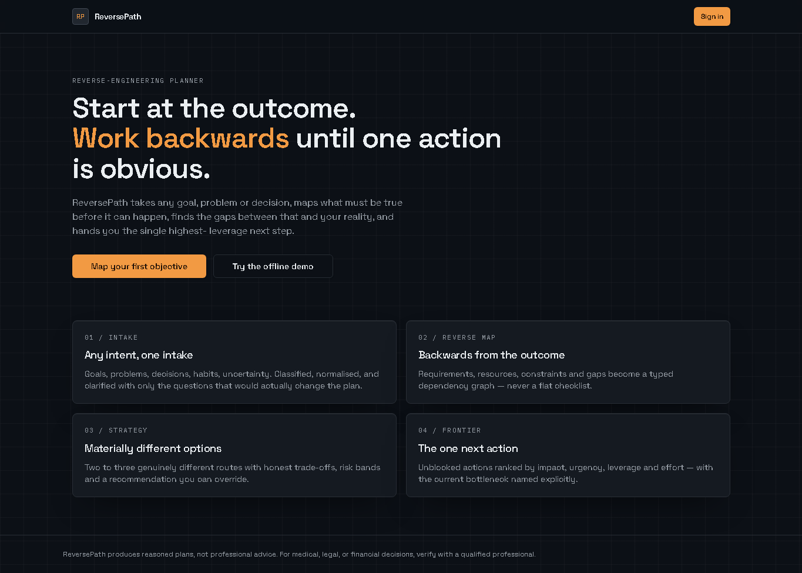
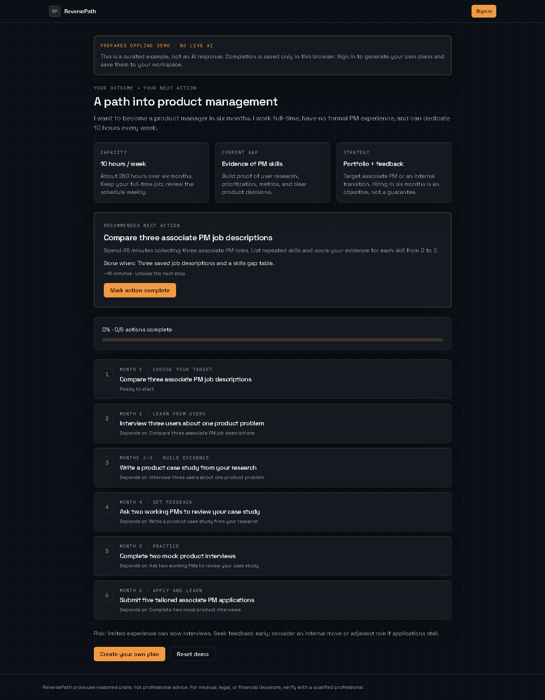
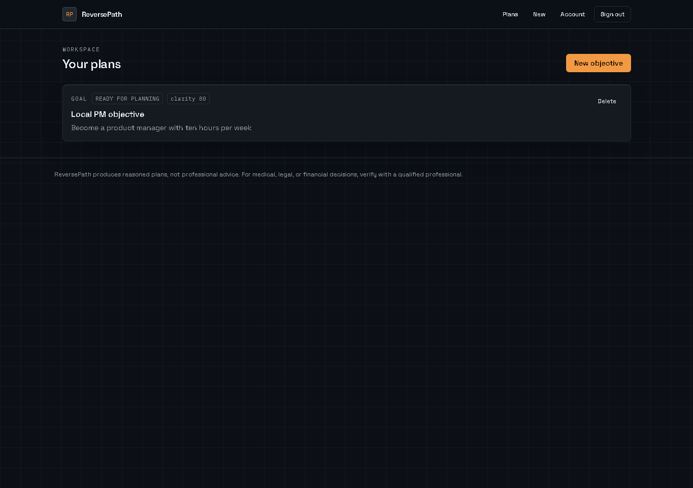
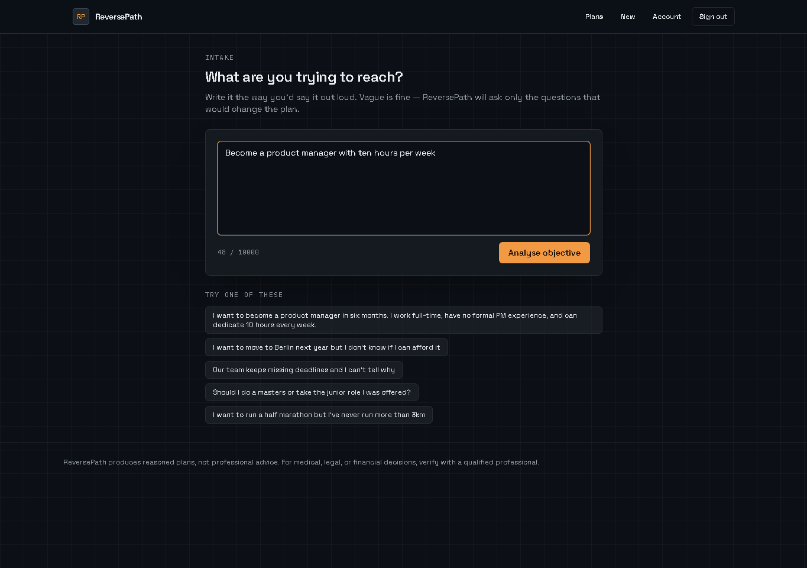
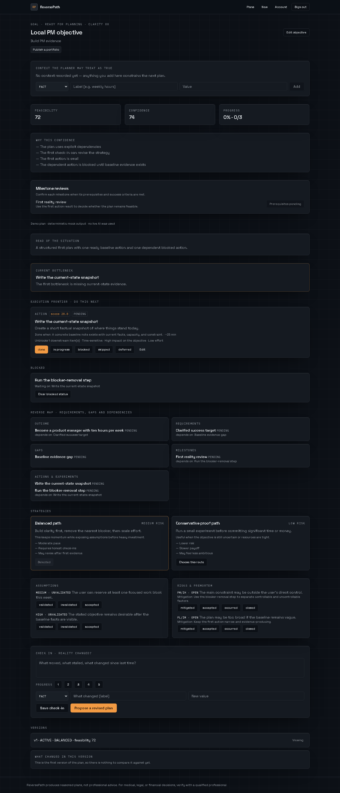
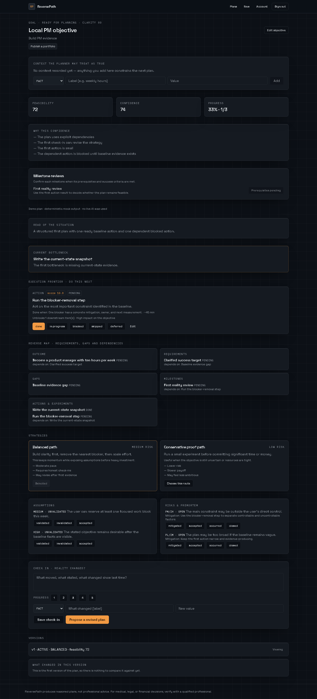
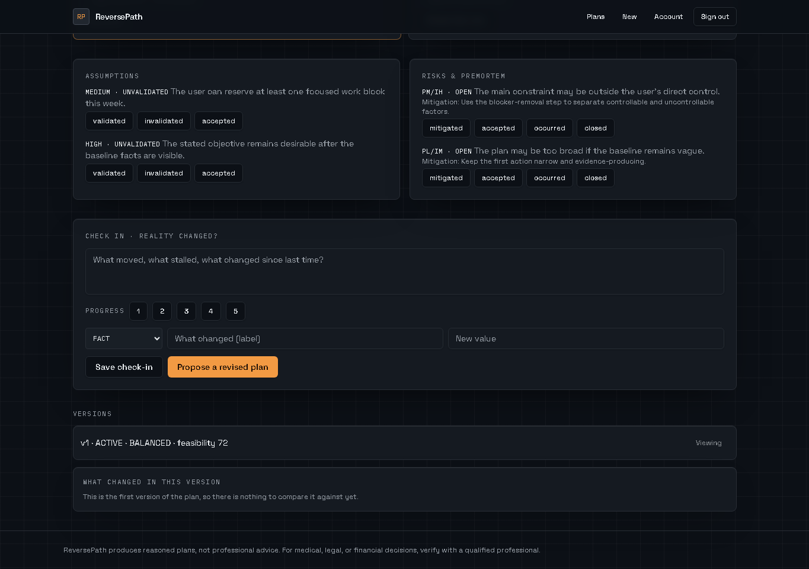
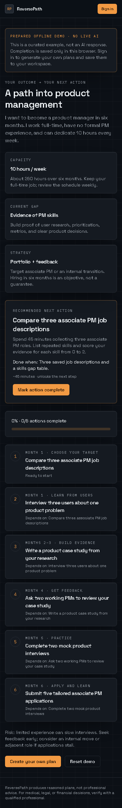
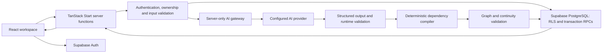

# Retraza-Kaaush

**Turn an outcome into a structured execution plan, then work through the next actionable step.**

Retraza-Kaaush, presented in the interface as **ReversePath**, is a full-stack planning workspace for goals, problems and decisions. It works backward from an outcome: identify what must be true, compare requirements with available resources, expose gaps, evaluate strategies and map real dependencies.

The workspace connects planning to execution through ranked next actions, completion criteria, progress, check-ins and versioned revisions.

> **Release status:** the application and deterministic planning infrastructure are implemented. The protected Preview is available, but **live AI planning has not passed full acceptance**. All live providers remain disabled. The public demo uses explicitly labeled prepared data, not a live AI response.

[Preview](https://retraza-kaaush-preview-kaushik-yellanki-project.vercel.app) · [Public demo](https://retraza-kaaush-preview-kaushik-yellanki-project.vercel.app/demo) · [Architecture](docs/DEEP_TECHNICAL_ARCHITECTURE.md) · [Verification evidence](docs/FINAL_HOSTED_LAUNCH_STATUS.md)

## Project Overview

Retraza is designed for career changes, learning projects, product ideas and other uncertain objectives. It separates the desired outcome from the route used to reach it and makes constraints and assumptions visible.

1. Describe an objective in natural language.
2. Classify intent and clarify information that would materially change the plan.
3. Capture facts, resources, constraints and measurable success criteria.
4. Compare strategies, risks, assumptions and dependencies.
5. Work from the executable frontier: actions whose hard prerequisites are satisfied.
6. Record completion evidence and check in when circumstances change.
7. Review candidate revisions, inspect changes and accept or reject them while preserving accepted history.

Progress comes from execution state, not an AI estimate. Replanning creates a new version instead of overwriting the accepted plan.

## Application Screenshots

These are real local application screenshots captured with Playwright. **All goals, private-workspace records and authenticated sessions shown are synthetic demonstrations.** Auth and server-function responses were intercepted; no shared Supabase users or records were created. The public demo is a separate curated example.

### Landing Page

The public entry point introduces reverse-engineered planning.



### Prepared Public Demo

A fictional product-management objective with its prepared-data notice visible.



### Dashboard And Goal Intake

Synthetic signed-in workspace and natural-language objective entry.





### Strategies And Dependencies

<details>
<summary>View the complete synthetic planning workspace</summary>

Requirements, gaps, milestones and actions appear alongside strategy comparison, assumptions and risks.



</details>

### Actions And Progress

<details>
<summary>View the synthetic completed-action state</summary>

A fixture update marks one action complete and changes progress and the next action. This is not evidence of a remote database write.



</details>

### Check-ins And Version History

The fixture shows revision controls, one active version and the first-version empty diff state, not a successful live AI replan.



### Mobile Interface

The prepared public demo at a 390-pixel viewport.



[Screenshot evidence and reproduction instructions](docs/screenshots/README.md).

## Features

| Area              | Implemented behavior                                                                          |
| ----------------- | --------------------------------------------------------------------------------------------- |
| Public experience | Landing page and prepared offline demo with browser-local completion                          |
| Authentication    | Supabase email/password, Google OAuth, callbacks, session recovery and sign-out states        |
| Workspace         | Per-user dashboard, objective editing and context facts                                       |
| Intake            | Intent classification, normalized objectives and focused clarification                        |
| Planning          | Structured AI integration and deterministic dependency compilation                            |
| Decision support  | Two-strategy contract, comparison, feasibility/confidence explanations, assumptions and risks |
| Execution         | Ranked unblocked actions, status updates, completion evidence and progress                    |
| Reflection        | Check-ins and updated facts                                                                   |
| Replanning        | Candidate versions, change explanations, acceptance/rejection and prior-version preservation  |
| Account           | Settings and user-owned JSON export with visible failure states                               |
| Responsive UI     | Desktop, tablet and mobile layouts with deterministic browser coverage                        |

Implementation is not live verification. See [Current Project Status](#current-project-status).

## Technology Stack

| Layer                | Technologies                                                              |
| -------------------- | ------------------------------------------------------------------------- |
| Language/runtime     | TypeScript, Node.js 24, npm                                               |
| Frontend             | React 19, TanStack Router and TanStack Query                              |
| Full-stack framework | TanStack Start server functions and SSR                                   |
| Styling/components   | Tailwind CSS 4, Radix UI and Lucide                                       |
| Build/server output  | Vite 8 and Nitro; Node-server and Vercel targets                          |
| Backend              | Supabase PostgreSQL, Auth, RLS and transaction RPCs                       |
| Object storage       | Supabase Storage adapter; structured records stay in PostgreSQL           |
| AI                   | Vercel AI SDK, Google and OpenAI-compatible adapters, server-side routing |
| Contracts            | Zod validation and provider-compatible JSON Schema                        |
| Tests                | Vitest, local PGlite PostgreSQL tests and Playwright                      |
| Hosting              | Independent Vercel Preview with Deployment Protection                     |

The npm lockfile is authoritative. Historical Bun files are not the release installation workflow.

## System Architecture



Server functions derive ownership from the authenticated session rather than trusting a client-supplied user ID. RLS, ownership checks and database RPCs add enforcement at the persistence boundary.

Plans are validated before persistence. Transaction RPCs save related records atomically; activation maintains a single active version. Candidate acceptance is separate from generation. Replanning must preserve completion evidence and accepted history.

Implementation: [architecture](docs/DEEP_TECHNICAL_ARCHITECTURE.md) and [migrations](supabase/migrations).

## AI Planning Architecture

The provider produces a **semantic plan**, not arbitrary database rows or an unrestricted graph:

- Strategies own milestones and executable work.
- Named references identify genuine prerequisites within the owning strategy. Acyclic forward references are supported; declaration order does not determine validity.
- HIGH-importance assumptions require executable validators.
- Deterministic code constructs node identities, ownership relationships and dependency edges.
- Validation rejects missing references, self-dependencies, actual cycles, invalid milestone/action counts and broken strategy branches.
- Replanning preserves completed and in-progress work without inventing replacement evidence.
- Only valid output reaches atomic persistence. Live mode never silently substitutes mock output after provider failure.

The compact profile targets three recommended milestones, six to eight steps and three assumptions/risks when sufficient, preserving accepted ranges and continuity.

**Current limitation:** the latest isolated OpenRouter response was complete and schema-valid but rejected by the final milestone-count rule. It was not a usable-plan PASS. Gemini is inactive, Groq is disabled and no live provider is active. Historical diagnostics remain in the [verification report](docs/FINAL_HOSTED_LAUNCH_STATUS.md).

## Installation

Requirements: **Node.js 24.x**, npm and Git. Supabase public configuration initializes the app; a configured backend is required for real sign-in and saved work. Browser tests require Playwright Chromium.

### Windows PowerShell

```powershell
git clone https://github.com/YellankiKaushik/Retraza-Kaaush.git
Set-Location Retraza-Kaaush
npm.cmd ci
Copy-Item .env.example .env
# Configure the ignored .env locally; never paste or commit private values.
npm.cmd run dev -- --host 127.0.0.1
```

Open the URL printed by Vite, usually `http://localhost:5173`. The public example is at `/demo`. The example defaults to `AI_PROVIDER_MODE=mock` for deterministic development; this does not establish live AI capability.

### macOS / Linux

```sh
git clone https://github.com/YellankiKaushik/Retraza-Kaaush.git
cd Retraza-Kaaush
npm ci
cp .env.example .env
# Configure .env locally.
npm run dev -- --host 127.0.0.1
```

### Production Builds

```powershell
npm.cmd run build:node
npm.cmd start
# Independent Vercel build output:
npm.cmd run build:vercel
```

On Unix, use `npm` instead of `npm.cmd`. Node output is `.output/server/index.mjs`; Vercel output is `.vercel/output`. This is a server application, not a static-only SPA. Ordinary development needs no globally installed Supabase or Vercel CLI.

## Environment Variables

Use [.env.example](.env.example) for names and placeholders. Private values belong in ignored local files or the hosting platform's secret store.

| Scope                   | Variable names                                                                                                                                                                                                                         | Purpose                                               |
| ----------------------- | -------------------------------------------------------------------------------------------------------------------------------------------------------------------------------------------------------------------------------------- | ----------------------------------------------------- |
| Browser-public          | `VITE_SUPABASE_URL`, `VITE_SUPABASE_PUBLISHABLE_KEY`, `VITE_SUPABASE_PROJECT_ID`                                                                                                                                                       | Public client initialization; never put a secret here |
| Server backend          | `SUPABASE_URL`, `SUPABASE_PUBLISHABLE_KEY`, `SUPABASE_SERVICE_ROLE_KEY`                                                                                                                                                                | Privileged credentials remain server-only             |
| Application             | `PUBLIC_APP_URL`, `APP_ENV`, `AI_GENERATION_ENABLED`                                                                                                                                                                                   | Origin and environment controls                       |
| Routing                 | `AI_PROVIDER_MODE`, `AI_PROVIDER_ALLOWLIST`, `AI_ROUTE_FAST`, `AI_ROUTE_PRIMARY`, `AI_ROUTE_CRITIC`, `AI_ROUTE_FALLBACK`                                                                                                               | Mock/live mode and explicit provider selection        |
| Limits                  | `AI_MAX_OUTPUT_TOKENS`, `AI_PROVIDER_TIMEOUT_MS`, `AI_PROVIDER_MAX_RETRIES`, `AI_DAILY_REQUEST_LIMIT`                                                                                                                                  | Output, latency, retry and usage controls             |
| OpenRouter, private     | `OPENROUTER_API_KEY`, `OPENROUTER_BASE_URL`, `OPENROUTER_ENABLED`, `OPENROUTER_PROVIDER_ONLY`, `OPENROUTER_MODEL_DEFAULT`, `OPENROUTER_MODEL_FAST`, `OPENROUTER_MODEL_PRIMARY`, `OPENROUTER_MODEL_CRITIC`, `OPENROUTER_MODEL_FALLBACK` | Implemented adapter; leave disabled until verified    |
| Other adapters, private | `GEMINI_API_KEY`, `GROQ_API_KEY`, `OPENAI_API_KEY`, `LOVABLE_API_KEY`, with enabled/model settings                                                                                                                                     | Optional integrations, not verified availability      |
| Storage                 | `OBJECT_STORAGE_PROVIDER`, `SUPABASE_STORAGE_BUCKET`                                                                                                                                                                                   | Server storage adapter                                |
| Test safety             | `RETRAZA_TEST_BACKEND_MODE`, `RETRAZA_SHARED_TEST_APPROVAL_FILE`, `RETRAZA_TEST_RUN_ID`                                                                                                                                                | Read-only default and approved exact-run scope        |

Modern `sb_publishable_...` and `sb_secret_...` keys are supported. `SUPABASE_SERVICE_ROLE_KEY` can hold a modern secret key; a legacy JWT is not required.

Credential authentication or HTTP 200 does not establish usable AI planning. Parsing, semantic compilation and final validation are separate gates.

## Supabase Configuration

Supabase stores user-owned intake cases, plans, versions, nodes/edges, strategies, assumptions, risks, actions, check-ins, changes, usage and auditing. Migrations define RLS, ownership enforcement, indexes and transactional operations.

**The configured remote backend is shared and read-only by default for verification. Do not replay migrations, reset schema, change shared Auth settings or run database-writing tests without separate project-specific owner approval.** Structural compatibility was previously verified; publication does not reapply or reverify remote schema.

Follow [shared compatibility](docs/SHARED_SUPABASE_COMPATIBILITY.md) for the existing backend. For a new backend, review migrations before the normal tracked workflow. Never run bootstrap/reset SQL blindly against a populated project.

Authentication requires reviewed site/callback origins. Google sign-in on the stable Preview is owner-verified. Email-confirmation delivery remains unverified.

## Running Tests

Normal tests are deterministic. Keep live gates disabled:

```powershell
$env:RETRAZA_TEST_BACKEND_MODE="read-only"
$env:RUN_SUPABASE_RLS_TESTS="false"
$env:RUN_E2E_GOLDEN="false"
$env:RUN_E2E_SIGNUP="false"
$env:RUN_E2E_SCENARIOS="false"
$env:RUN_LIVE_AI_SMOKE="false"
$env:RUN_LIVE_DEMO_PLAN="false"
$env:RUN_OPENROUTER_PLAN_SMOKE="false"
```

| Check                             | PowerShell command                                    |
| --------------------------------- | ----------------------------------------------------- |
| All deterministic tests           | `npm.cmd test`                                        |
| Unit                              | `npm.cmd run test:unit`                               |
| Mock integration                  | `npm.cmd run test:integration`                        |
| Local PostgreSQL, PGlite          | `npm.cmd run test:db`                                 |
| Install browser                   | `npx.cmd playwright install chromium`                 |
| Browser                           | `npm.cmd run test:e2e`                                |
| Typecheck                         | `npm.cmd run typecheck`                               |
| Lint                              | `npm.cmd run lint`                                    |
| Builds                            | `npm.cmd run build:node` / `npm.cmd run build:vercel` |
| Source/history/client secret scan | `npm.cmd run check:secrets`                           |

Unix uses `npm`/`npx` and `export VARIABLE=value`. PowerShell uses `$env:VARIABLE="value"`, not Unix inline assignments.

Live RLS and hosted acceptance require fresh catalog evidence, owner-authored approval, unused run ID, expiry, provider limits and exact-run cleanup. Ordinary tests do not authorize shared writes.

## Deployment

The existing independent Vercel project is **retraza-kaaush**. Its [stable Preview](https://retraza-kaaush-preview-kaushik-yellanki-project.vercel.app) may require Vercel authentication because Deployment Protection is enabled.

The server build uses browser-public configuration at build time and private credentials in server environment configuration. Preserve server-function routing and origin-scoped authentication; never upload secrets as public Vite variables.

The Preview serves the frontend and server with live providers disabled. Repository publication is not Production promotion. Do not connect automatic Git deployments or promote domains without reviewing release effects.

No public Production release is claimed. Production needs a validated provider, hosted acceptance and separate approval. See the [release checkpoint](docs/HOSTED_AUTH_AND_PRODUCTION_CHECKPOINT.md).

## Security

- Environment files, logs and approval evidence are ignored by Git.
- Privileged Supabase and AI credentials remain server-only.
- Server operations authenticate sessions, validate inputs and enforce ownership.
- RLS and ownership-aware RPCs add database-layer enforcement.
- AI output is untrusted until schema, reference, graph and continuity checks pass.
- Candidate generation does not automatically replace accepted work.
- Diagnostics retain safe classifications/counts, not prompts, credentials or raw private responses.
- Shared test guards restrict mutations to approved exact-run records and cleanup targets.

These safeguards do not replace deployed-environment review or live acceptance evidence.

## Current Project Status

Reviewed October 23, 2026.

| Area                                  | Status                                                            |
| ------------------------------------- | ----------------------------------------------------------------- |
| Screens and server workflows          | Implemented, deterministic coverage                               |
| Public prepared demo                  | Verified browser-local example without AI                         |
| Responsive UI                         | Deterministic desktop/mobile browser coverage                     |
| Supabase schema and two-user RLS      | Previously verified in controlled runs, not rerun for publication |
| Google authentication                 | Owner-verified on stable Preview                                  |
| Compiler, dependencies and continuity | Verified offline                                                  |
| Live provider planning                | **Not accepted; no active live provider**                         |
| Full hosted real-AI lifecycle         | Pending fresh approval after valid provider output                |
| Email confirmation delivery           | Unverified                                                        |
| Independent Vercel Preview            | Ready and protected                                               |
| Production release                    | Pending, not promoted                                             |

The latest isolated OpenRouter output was complete and schema-valid but rejected by milestone-count validation. Demo/screenshots are not live AI acceptance.

Canonical evidence: [verification report](docs/FINAL_HOSTED_LAUNCH_STATUS.md). Historical investigations and handoffs remain under [docs](docs), separate from this introduction.

## Project Structure

```text
src/
  routes/                    File-based routes and page interfaces
  components/                Shared application and UI components
  domain/                    Graph, frontier, ranking and progress logic
  ai/                        Prompts, schemas, orchestration and compiler
  lib/                       Server functions, persistence and security
  integrations/supabase/     Client/server authentication and database types
  hooks/                     React hooks and authentication state
supabase/migrations/         Versioned schema, RLS and transaction RPCs
tests/unit/                 Deterministic domain and contract tests
tests/integration/          Mock SDK and source-handler coverage
tests/db/                   Local PGlite tests and gated live RLS
tests/e2e/                  Browser coverage and gated live workflows
scripts/                    Build, environment, security and approval tooling
docs/                       Architecture, evidence, handoff and screenshots
```

## Future Improvements

- Establish consistently valid live planning without weakening the contract.
- Complete separately approved hosted lifecycle and email-delivery verification.
- Finish reviewed Production release after those gates pass.

These are remaining reliability/verification goals, not completed-feature claims.

## Credits And Acknowledgments

Maintained by **Kaushik Yellanki / YellankiKaushik**. The interface retains the **ReversePath** name.

Existing Lovable integration and history are preserved. The owner's [Reverse-Engg-VibeSprint](https://github.com/YellankiKaushik/Reverse-Engg-VibeSprint) repository served as a read-only reference; its deployment and results are not Retraza evidence.

React, TanStack, Supabase, Vite, Tailwind CSS, Radix UI, Lucide, the AI SDK and other dependencies remain their authors' work and retain their licenses.

## License

No repository-level `LICENSE` or `COPYING` file is currently provided. This README grants no open-source license or change of ownership. Contact the owner regarding reuse; dependency licenses apply independently.
